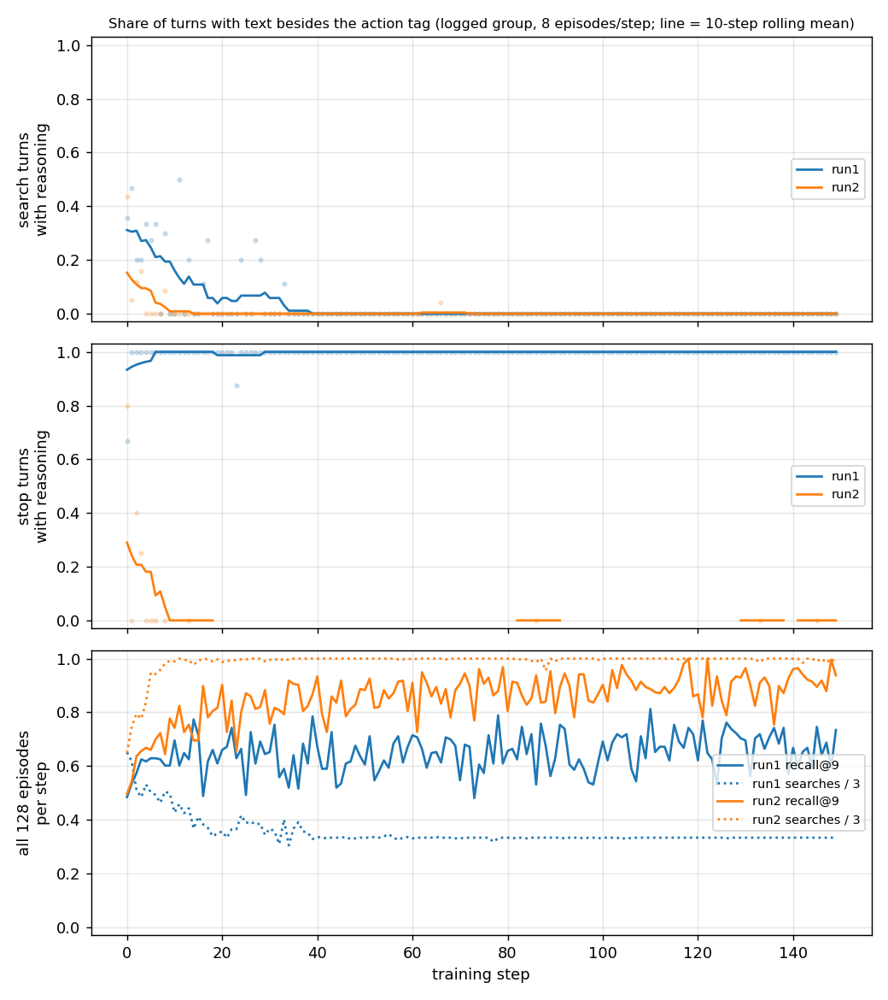

# Reasoning text and search habits in Exp 01 (run1, run2)

Single seed per run; everything below is an observation about these runs. Scripts:
`analysis/reasoning.py`, `analysis/habit.py` (es_debug job via `analysis/run.sh`, ~10 s); raw output
in `reasoning.txt`, `habit.txt`, `habit_tables.md`.

**Data.** Training rollouts log one group (8 episodes of one question) per step, steps 0-149, with
turns stored as plain strings and no `retrieved` or gold field. I re-parsed the turns with
`env.parse_turn` and took gold from `train.jsonl` by question text. Per-search hits were re-run on
the env's BM25 (k=3). Checks: the re-run union equals the stored `retrieved` in 200/200 eval episodes
for each system, and on run2's rollouts the re-run recall + 0.2·format equals the logged reward in
1200/1200 episodes.

## 1. Reasoning text (text left after removing the action tag and whitespace)

| eval, 200 q | search turns with text | stop turns with text | mean chars (search / stop) |
|---|---|---|---|
| prompted | 67/416 (0.16) | 73/118 (0.62) | 13.9 / 38.1 |
| run1 | 0/200 | 200/200 | 0 / 49.4 |
| run2 | 0/594 | 0/6 | 0 / 0 |

- **The first search turn is bare in every system, including the prompted model (0/200).** Text
  only appears on follow-up searches (prompted: 2nd 48/145, 3rd 19/71). So the share of search turns
  with text mostly reflects how many follow-up searches there are.
- **run1:** follow-up searches keep their text (steps 10-40: 20/20 with text). The search-turn share
  falls because follow-ups disappear (searches per episode reach ~1.0 by step ~18 and stay there from
  ~40), not because the text gets shorter. Stop turns keep text throughout (100%). Their mean length
  drops from ~81 characters at steps 0-50 to ~46-52 later, which matches the "Now I have the novel's
  author…" template.
- **run2:** text on follow-up searches goes from 13/125 at steps 0-10 to 0/478 at steps 10-40. Text
  on stop turns goes from 7/25 at steps 0-25 to 0 later, but there are few stop turns. The drop
  happens together with the rise to 3 searches (2.98 at step 9), while recall@9 is still rising
  (0.50 at step 0, ~0.78 at step 9, ~0.9 by step 36). So the text is gone before recall levels off.
- Examples (raw turns, `reasoning.txt`):
  - run1, early: `The film starred an actor, director, and musician who have a star on the Hollywood Walk of Fame. <done/>` (step 4).
  - run1, late: `Now I have the novel's author and the university's founding year. <done/>` (step 141).
  - run2, early and late: bare tags such as `<search>Marching Through Georgia</search>` (step 9) and `<search>Norwegian Lundehund dog</search>` (step 147).
  - The run2 rollouts do contain early reasoned turns, e.g. step 0: `I have found a connection between the book … Now, I need to know the director of "Home". <search>…`.

## 2. Are searches used out of habit? (eval, 200 questions)

| system | search | n | exact repeat | mean new passages | gold still missing before | adds new gold |
|---|---|---|---|---|---|---|
| prompted | 1 | 200 | 0 | 3.00 | 200 | 177 (0.89) |
| prompted | 2 | 145 | 23 (0.16) | 1.93 | 127 | 35 (0.24) |
| prompted | 3 | 71 | 57 (0.80) | 0.21 | 54 | 3 (0.04) |
| run1 | 1 | 200 | 0 | 3.00 | 200 | 177 (0.89) |
| run2 | 1 | 200 | 0 | 3.00 | 200 | 180 (0.90) |
| run2 | 2 | 200 | 0 | 2.50 | 184 | 147 (0.73) |
| run2 | 3 | 194 | 0 | 1.62 | 49 | 21 (0.11) |

- **Prompted:** its 3rd search is a verbatim repeat 80% of the time and adds 0.21 new passages, so
  its third search does nothing. That is a habit in the plain sense.
- **run2:** it never repeats a query. Its 3rd query still finds 1.62 new passages on average, so it is
  a real new query. But **in 145 of 194 episodes all gold was already found before the 3rd search.**
  When gold was still missing (49 episodes), the 3rd search found it in 21 (43%). The 3rd search
  looks like a habit in that it is issued whatever the state, not like a repeated query. Nothing in
  the training reward pays for stopping.

run2 rollouts, 3rd search by step bucket. Exact repeats vanish after step 50 (2nd + 3rd searches:
23 at steps 0-25, 10 at 25-50, 0 after). The rest shows no trend:

| steps | 0-25 | 25-50 | 50-75 | 75-100 | 100-125 | 125-150 |
|---|---|---|---|---|---|---|
| 3rd searches issued | 171 | 199 | 199 | 196 | 200 | 191 |
| gold still missing before | 94 | 61 | 69 | 78 | 76 | 59 |
| adds new gold | 17 | 30 | 22 | 25 | 29 | 11 |
| mean new passages | 1.40 | 1.40 | 1.18 | 1.44 | 1.65 | 1.61 |

Full per-position table: `habit_tables.md`.

## README sanity checks (all agree)

- run2's 3rd query adds new gold in 21/194: **21/194** ✓.
- Prompted repeats a query in 78/200 episodes: **78/200** ✓.
- Prompted turns that are a bare action: 394/545 ✓ (151 of 545 turns have text).
- All 600 run2 eval turns are bare ✓, and all run1 search turns are bare ✓.

## Surprising

- The prompted model never writes reasoning before its first search, even though the few-shot
  example does ("First I need…"). So "the text disappears in training" only applies to follow-up
  and stop turns. Checked that this is not a decoding artifact. All 200 first turns start with
  `<search>`. Re-encoding every turn's text gives back exactly `n_generated` tokens in 189/200
  episodes and one token more in 11. Those 11 match the 11 malformed episodes, whose last turn ends
  on `<|im_end|>`, a special token removed when decoding. So no visible text is lost. Eval decoding is
  greedy (temperature 0). At temperature 1, at step 0 of training, first searches have text in 2/159
  (run1 0/79, run2 2/80), and every other prompted output dir shows 0-1 per 200 episodes.
- run1 never dropped its stop-turn text; it froze into a template. run2 dropped all text within ~10 steps.
